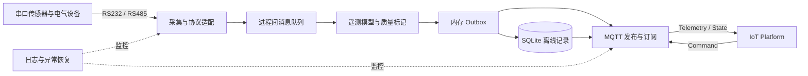
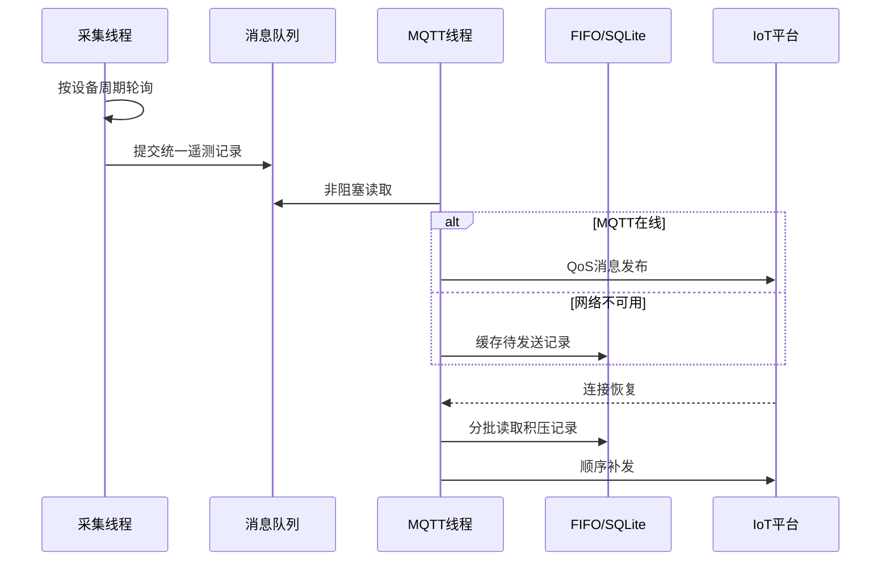
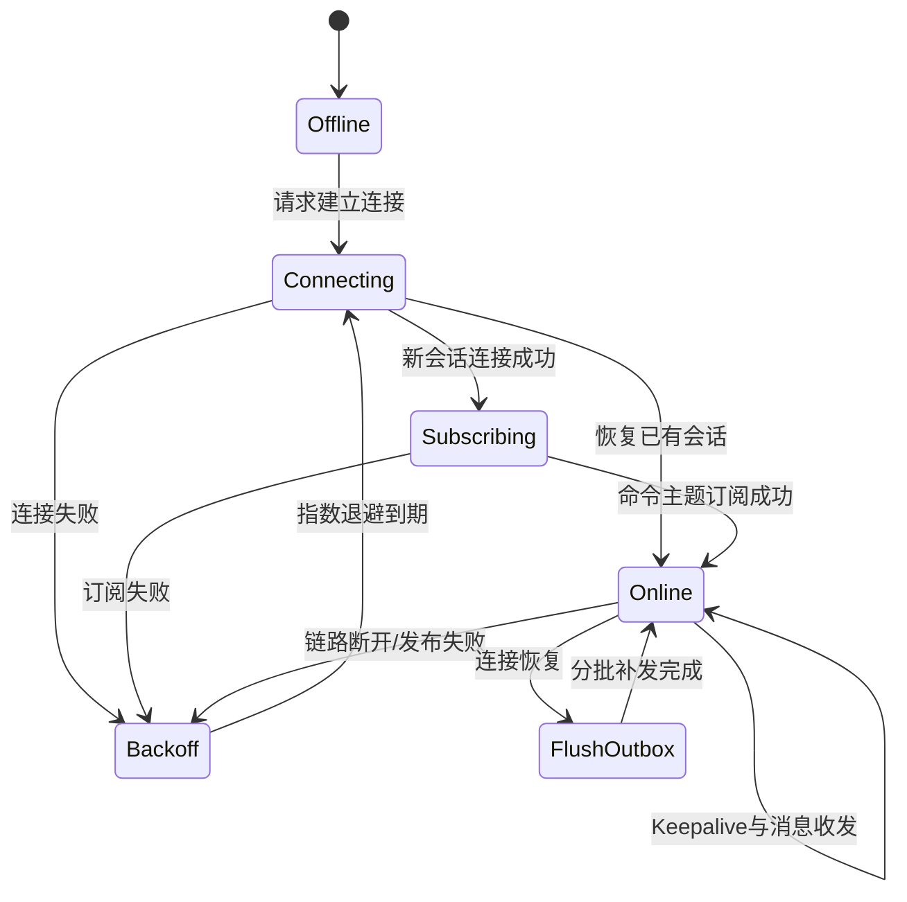
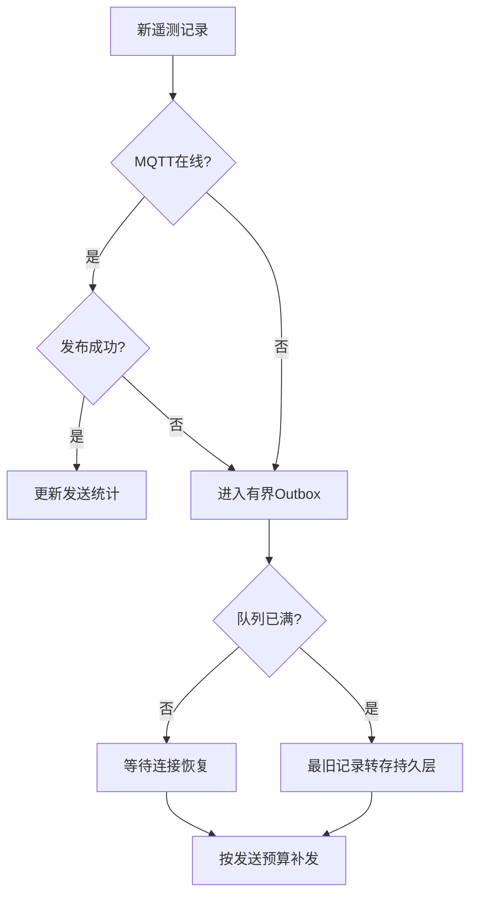

# 电力物联网边缘网关

> **Author: Hzhikai · 原创技术作品 · 开源交流学习 · MIT Licensed**

面向配电站房环境监测与设备接入的嵌入式 Linux 网关项目。原系统在边缘侧统一管理串口传感器，通过多线程和进程间消息队列解耦采集与上报，并使用 MQTT 完成遥测发布、状态同步、命令订阅和断线恢复。

本仓库中的公开代码、架构设计与技术文档由 **Hzhikai** 基于本人实际项目经验独立整理并授权发布，用于嵌入式技术交流、开源共同学习与求职作品展示。欢迎阅读、引用、讨论和改进，并请保留作者与许可证信息。

公开内容依据真实模块职责完成脱敏整理，不包含企业代码、真实 Broker、设备身份、鉴权信息、私有 Topic、客户数据及第三方二进制库。

## 项目概览

| 项目维度 | 说明 |
| --- | --- |
| 目标平台 | RK3568 类嵌入式 Linux 网关 |
| 开发语言 | C |
| 并发模型 | pthread 采集线程与 MQTT 上报线程 |
| 设备接入 | UART、RS232、RS485、多通道传感器轮询 |
| 消息通信 | System V Message Queue、有界 FIFO |
| 云端通信 | MQTT 发布/订阅、回调处理、心跳和重连 |
| 离线保障 | 内存队列、SQLite 历史记录、恢复后补发 |
| 工程组件 | Paho MQTT C、cJSON、SQLite、zlog、CMake |

## 原项目核心功能

- 从配置中加载多串口与多设备信息，按照独立周期轮询现场传感器。
- 接入温湿度、烟雾、水浸、气体、电气状态等环境与安全数据。
- 使用 pthread 分离设备采集、数据处理和 MQTT 平台通信职责。
- 通过 System V 消息队列传递采集记录，降低串口逻辑与云端协议耦合。
- 基于 MQTT 完成遥测上报、设备状态同步、命令订阅和处理结果回复。
- 网络不可用时将待上报数据放入 FIFO，并按策略写入 SQLite 持久层。
- 连接恢复后按预算分批补发，避免积压数据阻塞实时采集。
- 提供 UDP、本地配置、日志、GPIO 输出和告警联动等网关能力。

以上内容描述原项目整体工程职责；当前仓库重点公开 MQTT 数据链路及其周边通用设计。

## 系统架构



## 线程协作与数据流



## MQTT 协议设计

### 主题模型

公开实现将主题划分为遥测、状态、命令和回复四类，并对命名空间与设备标识执行长度和字符检查：

```text
{namespace}/devices/{device-id}/telemetry
{namespace}/devices/{device-id}/state
{namespace}/devices/{device-id}/command
{namespace}/devices/{device-id}/reply
```

真实平台 Topic、产品标识和设备身份未收录。

### 会话与重连状态机



`mqtt_session` 不直接依赖 Paho API，而是输出连接、订阅、PING 和补发动作。实际 MQTT 客户端只需将回调结果反馈给状态机，便于替换通信库或进行平台移植。

### 离线存储与恢复补发



内存队列采用固定容量，溢出时保留最新数据并将最旧记录交给持久化接口。补发设置单轮预算，防止历史数据长期占用 MQTT 线程。

## 公开代码模块

| 模块 | 路径 | 展示重点 |
| --- | --- | --- |
| MQTT会话 | `src/mqtt_session.c` | 连接、订阅、Keepalive、退避重连与会话恢复 |
| Topic构建 | `src/mqtt_topic.c` | 主题分层、字符校验与缓冲区边界 |
| 存储转发 | `src/store_forward.c` | 在线直发、离线缓存、溢出持久化与限量补发 |
| 遥测队列 | `src/telemetry_queue.c` | 固定容量环形队列与溢出统计 |
| 遥测模型 | `src/telemetry.c` | 设备、时间戳、测点与数据质量统一表达 |
| CRC16 | `src/crc16.c` | RS485/Modbus 数据帧校验基础 |
| 平台适配 | `platform/reference_adapter.c` | MQTT发布与SQLite持久化接口边界 |
| 功能入口 | `examples/gateway_flow.c` | 串联离线缓存、上线和补发过程 |

## 关键技术设计

### MQTT 与业务逻辑解耦

上报模块依赖 `pg_delivery_port_t`，不直接保存 Broker 地址、账号或具体 SDK 对象。Paho MQTT、其他 MQTT 库或本地调试适配器均可接入同一接口。

### 有界缓冲与背压

队列容量由调用方提供，不使用动态内存。代码显式记录溢出次数，并通过持久化回调处理被替换的旧记录，使内存消耗保持可预测。

### 数据质量标记

每个测点携带 `GOOD`、`STALE` 或 `INVALID` 状态，避免通信失败时把默认值误当成真实测量结果上传。

### 有上限的指数退避

MQTT 连接失败后逐步延长重试间隔，并设置最大值，降低网络故障时的 CPU 占用和 Broker 压力；成功建立会话后清零失败计数。

## 目录结构

```text
.
├── include/power_gateway/  # MQTT、遥测与存储转发接口
├── src/                    # 通用核心实现
├── platform/               # 参考平台适配层
├── examples/               # 功能展示入口
├── docs/                   # 展示材料说明
├── CMakeLists.txt          # 可选 Host 构建入口
├── AUTHORS.md              # 作者与授权
├── PUBLICATION_SCOPE.md    # 公开边界
└── README_EN.md            # English overview
```

## 关于构建

公开代码按 ISO C11 组织并提供可选 CMake 入口。仓库不包含原产品的交叉编译工具链、rootfs、第三方二进制库及硬件配置，也不声明能够直接部署到现场设备。

```bash
cmake -S . -B build
cmake --build build
./build/gateway_flow
```

本次整理未在当前机器上执行编译或硬件验证，不将上述命令标记为已通过测试。

## 公开范围与限制

- 所有 Broker、Topic、Client ID、设备标识和时间参数均已通用化处理。
- 未包含真实账号、证书、服务器地址、客户设备数据或远程控制字段。
- 未包含原始量产工程、Web/Qt 工程、路由器配置、数据库文件和历史 Git 记录。
- 未重新分发 Paho MQTT、SQLite、cJSON、zlog、libcurl 等第三方源码或二进制文件。
- 未收录真实设备与现场图片；补充要求见 [`docs/IMAGES_TODO.md`](docs/IMAGES_TODO.md)。

完整说明见 [`PUBLICATION_SCOPE.md`](PUBLICATION_SCOPE.md)。

## License

仓库内由 **Hzhikai** 创作并公开发布的代码与文档采用 [MIT License](LICENSE)。作者与授权说明见 [`AUTHORS.md`](AUTHORS.md)。该许可**不适用于**未收录的原始量产工程、企业代码、第三方依赖、客户资料或私有协议。
